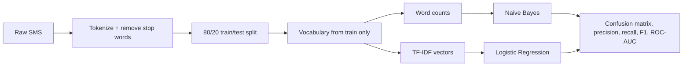
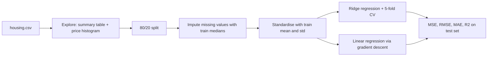

<h1 align="center">Spam Detection & House Price Prediction in Zig</h1>

<p align="center">
  Two classic machine-learning projects built <b>from scratch</b> in <b>Zig 0.16</b>.<br>
  No Python, no ML libraries, no dependencies: just the standard library.
</p>

<p align="center">
  
  
  
  
</p>

Built for the **QSkill AI & ML internship** (Task 2: Spam Mail Detector, Task 3: House Price Prediction).
Every algorithm (tokenizer, TF-IDF, Naive Bayes, logistic regression, ridge regression, gradient descent,
cross-validation, all metrics) is implemented by hand, so each step is visible in the code.

---

## Contents

- [Quick start](#quick-start)
- [Project layout](#project-layout)
- [Task 2: Spam mail detector](#task-2-spam-mail-detector)
- [Task 3: House price prediction](#task-3-house-price-prediction)
- [Design notes](#design-notes)
- [Limitations and next steps](#limitations-and-next-steps)

## Quick start

Requires [Zig 0.16](https://ziglang.org/download/). Datasets are included in `data/`.

```bash
# Spam detector: train, evaluate, then classify your own messages
zig build run-spam -- data/sms.tsv "WINNER!! claim your free prize now" "are we still meeting for lunch?"

# House price model: explore, train, evaluate
zig build run-house -- data/housing.csv
```

`zig build` on its own compiles both programs into `zig-out/bin/` (ReleaseFast by default;
use `-Doptimize=Debug` for a slow build with safety checks).

## Project layout

```text
.
├── build.zig          # build script: `spam` and `house` executables + run steps
├── data/
│   ├── sms.tsv        # 5,574 labelled SMS messages (UCI SMS Spam Collection)
│   └── housing.csv    # 20,640 California census block groups (1990)
└── src/
    ├── spam.zig       # Task 2
    └── house.zig      # Task 3
```

---

# Task 2: Spam mail detector

Classifies a text message as **spam** or **ham** (not spam) using two models trained side by side.



### Topics covered

| Topic | What it is | Where it appears |
|---|---|---|
| **Text preprocessing** | Lowercase the text, split it into words, drop very short words and *stop words* ("the", "and", "is"...) that carry little signal. | `tokenize` |
| **Bag of words** | Represent a message as word counts, ignoring order. | `countWordOccurrences` |
| **TF-IDF** | Weights a word up when it is frequent in the message (TF) and down when it appears in many messages (IDF), so rare, telling words like "prize" outweigh common ones. Vectors are L2-normalised. | `applyTfIdf` |
| **Train/test split** | 80% of messages train the model, 20% are held back to measure how it does on unseen data. The vocabulary and IDF come from the training set only, to avoid **data leakage**. | `main` |
| **Multinomial Naive Bayes** | Probabilistic classifier: picks the class with the higher `P(class) x product of P(word | class)`. Uses Laplace (add-one) smoothing so unseen words don't zero out a score. Fast and a strong baseline for text. | `NaiveBayesModel` |
| **Logistic regression** | Learns one weight per word; `sigmoid(w . x + b)` gives P(spam). Trained with stochastic gradient descent (SGD) and an L2 penalty to limit overfitting. | `LogisticRegressionModel` |
| **Evaluation metrics** | See below. | `ConfusionMatrix`, `computeRocAuc` |

**Reading the metrics.** With only ~13% spam, accuracy alone is misleading (always guessing "ham" scores 87%), so we also report:

- **Precision**: of the messages flagged as spam, how many really were? (Low precision means legitimate mail gets blocked.)
- **Recall**: of the real spam, how much did we catch? (Low recall means spam slips through.)
- **F1**: the harmonic mean of precision and recall, one number balancing both.
- **ROC-AUC**: the chance the model ranks a random spam message above a random ham one (1.0 is perfect, 0.5 is guessing).

### Results (1,114 held-out test messages)

| Model | Accuracy | Precision | Recall | F1 | ROC-AUC |
|---|---:|---:|---:|---:|---:|
| Multinomial Naive Bayes | 98.56% | 0.943 | 0.955 | **0.949** | 0.987 |
| Logistic Regression (TF-IDF) | 98.56% | **0.967** | 0.930 | 0.948 | **0.990** |

<table>
<tr><th>Naive Bayes</th><th>Logistic Regression</th></tr>
<tr><td>

|  | pred ham | pred spam |
|---|---:|---:|
| **actual ham** | 948 | 9 |
| **actual spam** | 7 | 150 |

</td><td>

|  | pred ham | pred spam |
|---|---:|---:|
| **actual ham** | 952 | 5 |
| **actual spam** | 11 | 146 |

</td></tr>
</table>

**Takeaway:** the two models are equally accurate but make different trade-offs. Naive Bayes catches more
spam (higher recall); logistic regression raises fewer false alarms (higher precision).

Most spam-indicative words found: `claim`, `prize`, `150p`, `tone`, `guaranteed`, `500`, `awarded`, `ringtone`.

```text
"free prize, call now"
  NB P(spam) = 0.999   LR P(spam) = 0.959
```

---

# Task 3: House price prediction

Predicts the median house value of a California census block group from 16 features
(location, house age, rooms, population, income, ocean proximity, and a few engineered ratios).



### Topics covered

| Topic | What it is | Where it appears |
|---|---|---|
| **Data exploration** | Per-feature min / mean / median / max / missing count, plus a histogram of prices, to spot problems before modelling. | `exploreData` |
| **Missing values** | 207 houses have no `total_bedrooms`. Filled with the **median** of the training set (robust to outliers). | `main` |
| **One-hot encoding** | `ocean_proximity` is a category, so it becomes five 0/1 columns. | `parseHousingCsv` |
| **Feature engineering** | Raw totals are misleading across differently sized areas, so we add `rooms_per_household`, `bedroom_ratio` and `people_per_household`. | `parseHousingCsv` |
| **Standardisation** | Rescale every feature to mean 0, std 1 (using training statistics only). Needed for gradient descent to converge and for coefficients to be comparable. | `main` |
| **Linear regression** | Predicts price as a weighted sum of features, `price = b + w1*x1 + ... + w16*x16`. | both models |
| **Gradient descent** | Starts with all weights at 0 and repeatedly steps them downhill along the gradient of the squared error until the loss stops falling. | `fitLinearRegressionByGradientDescent` |
| **Ridge regression** | Linear regression plus a penalty `lambda * sum(w^2)` that shrinks weights, helping when features are correlated. Solved exactly with the **normal equations** via Gaussian elimination with pivoting. | `fitRidgeRegression` |
| **Cross-validation** | The training set is split into 5 folds; each candidate `lambda` is trained on 4 and scored on the 5th, and the best average wins. The test set is never touched for tuning. | `main` |
| **Evaluation metrics** | See below. | `printTestMetrics` |

**Reading the metrics.**

- **MSE**: mean of squared errors (punishes big misses).
- **RMSE**: its square root, in dollars, so easy to interpret.
- **MAE**: average absolute miss in dollars, less sensitive to outliers.
- **R&sup2;**: fraction of price variance explained (1.0 is perfect, 0 is no better than predicting the mean).
- **Baseline**: always predicting the average price gives RMSE of about $115k, which is what the model has to beat.

### Data exploration highlights

- 414 missing cells = 207 houses missing `total_bedrooms`, which also blanks the derived `bedroom_ratio`.
- Prices are **capped at $500k** in this dataset, producing a spike in the last histogram bucket (1,294 houses).
- `rooms_per_hh` and `pop_per_hh` have extreme outliers (max 141 and 1,243), another reason to prefer median imputation.

```text
price distribution ($50k buckets, last bucket is 450k+):
     0k # 199
    50k ############################### 3397
   100k #################################### 3960
   150k ######################################## 4329
   200k ########################### 2926
   250k ################## 1963
   300k ########### 1214
   350k ######## 881
   400k #### 477
   450k ########### 1294
```

### Results (4,128 held-out test houses)

5-fold cross-validation picked **lambda = 100**:

| lambda | 0.01 | 0.1 | 1 | 10 | **100** | 1000 |
|---|---:|---:|---:|---:|---:|---:|
| CV RMSE ($) | 68,275 | 68,275 | 68,274 | 68,264 | **68,261** | 69,346 |

| Model | MSE | RMSE | MAE | R&sup2; |
|---|---:|---:|---:|---:|
| Baseline (predict the mean) | | $115,402 | | 0 |
| Linear regression (gradient descent) | 4.615e9 | **$67,935** | $49,064 | **0.654** |
| Ridge regression (lambda = 100) | 4.640e9 | $68,117 | $49,089 | 0.652 |

Both models cut the baseline error by about 41% and land almost on top of each other. The
penalty barely matters here because there are only 16 features and ~16,500 training rows, so
overfitting is not a problem.

**What drives price** (ridge coefficients, dollars per +1 standard deviation of the feature):

| Feature | Effect |
|---|---:|
| `median_income` | **+$77,917** |
| `longitude` | -$45,662 |
| `latitude` | -$44,926 |
| `population` | -$41,461 |
| `households` | +$33,551 |
| `bedrm_ratio` | +$15,524 |

Income dominates, which matches intuition. The large longitude/latitude coefficients encode "where in
California": prices fall moving inland and north. Population and households have opposite signs
because they are strongly correlated with each other.

---

## Design notes

- **From scratch.** The only import is `std`. Tokenizer, sparse vectors, TF-IDF, both classifiers, the
  linear solver, cross-validation and every metric are written out in `src/`.
- **Fast gradient descent.** The gradient of the squared error depends on the data only through
  `X^T X` and `X^T y`. Both are computed once, so each of the 5,000 epochs costs 16x16 operations
  instead of 16,512x16, with identical results. The whole house program runs in about 0.3 seconds.
- **No data leakage.** Vocabulary, IDF, imputation medians and standardisation statistics all come
  from the training split only.
- **Reproducible.** Fixed random seeds (42 for spam, 2026 for house) and a sorted vocabulary make every run
  give the same numbers.
- **Release builds by default.** Zig's `-Drelease` quirk would otherwise silently produce slow Debug
  binaries; `build.zig` defaults to ReleaseFast.

## Limitations and next steps

- A linear model cannot capture interactions or non-linear effects (e.g. location x income). R&sup2; of 0.65
  leaves clear room for **gradient-boosted trees** or **random forests**.
- Prices are capped at $500k, so the model systematically under-predicts the most expensive areas.
- Spam: a single random split is a noisy estimate; **k-fold cross-validation** and **n-gram features**
  ("call now", "free entry") would be natural upgrades.
- Class imbalance (13% spam) could be tuned further by choosing the decision threshold from a
  precision/recall curve instead of using 0.5.

## Data sources

- SMS Spam Collection: Almeida and Hidalgo, UCI Machine Learning Repository.
- California Housing: Pace and Barry (1997), 1990 US census data.
